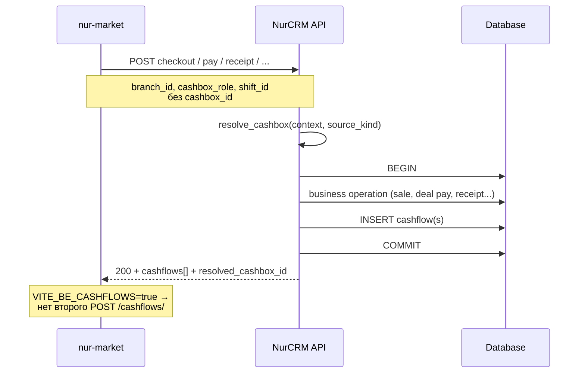

# Денежные операции на бэкенде: auto-cashflows + маршрутизация касс

**Фронт:** `nur-market`  
**Бэкенд:** NurCRM API (отдельный репозиторий)  
**Статус фронта:** готов — контекст маршрутизации в бизнес-API, без `cashBoxes[0]`  
**Статус бэка:** ✅ реализовано (auto-cashflows, маршрутизация, reject cascade) — см. [BACKEND-QUESTIONS.md](./BACKEND-QUESTIONS.md)

Связанные экраны: `/crm/market/cashier`, `/crm/kassa`, `/crm/pending`, `/crm/sell`, склад/закупки, долги, возвраты поставщику.

См. также: [realtime-notifications-backend.md](./realtime-notifications-backend.md), [shift-payment-breakdown-backend.md](./shift-payment-breakdown-backend.md).

---

## Содержание

1. [Цель и принципы](#цель-и-принципы)
2. [Архитектура](#архитектура)
3. [Модель данных](#модель-данных)
4. [Маршрутизация касс](#маршрутизация-касс)
5. [Общие поля запроса](#общие-поля-запроса)
6. [Модель cashflow в ответе](#модель-cashflow-в-ответе)
7. [Политика status](#политика-status)
8. [Идемпотентность](#идемпотентность)
9. [Эндпоинты по операциям](#эндпоинты-по-операциям)
10. [Смены](#смены)
11. [Ручная касса (без изменений)](#ручная-касса-без-изменений)
12. [Reject cascade](#reject-cascade)
13. [Ошибки](#ошибки)
14. [Real-time уведомления](#real-time-уведомления)
15. [Контракт фронта](#контракт-фронта)
16. [Выкат и флаги](#выкат-и-флаги)
17. [Тест-кейсы](#тест-кейсы)
18. [Приложение: legacy-маппинг](#приложение-legacy-маппинг)

---

## Цель и принципы

### Проблема (as-is)

Сейчас фронт после бизнес-операции **отдельным** `POST /construction/cashflows/` создаёт `income` / `expense`. Это:

| Проблема | Последствие |
|----------|-------------|
| Не атомарно | Продажа есть, записи в кассе нет |
| ~15 call-site на FE | Дублирование логики, расхождения |
| Выбор кассы на FE | Берётся `cashBoxes[0]` — неверная касса при нескольких кассах |
| `source_business_operation_id` через i18n | На ky reject в Pending ломает откат продажи |

### Цель (to-be)

1. **Бэк** создаёт cashflow **внутри** бизнес-транзакции (одна DB-транзакция).
2. **Бэк** выбирает кассу по `branch_id`, `cashbox_role`, открытой смене — не фронт.
3. Фронт при `VITE_BE_CASHFLOWS=true` **не** POST-ит авто-flows.
4. Ручной ввод в `/crm/kassa` остаётся через `POST /construction/cashflows/`.

### Инварианты

- **Запрещено** молча брать `results[0]` из `GET /construction/cashboxes/`.
- Если `amount > 0` и кассу нельзя определить → **400**, не silent fallback.
- Если денег нет → `cashflows: []`, касса не обязательна.
- Extra-поля в JSON (`branch_id`, `cashbox_role`, `cashflows`) — обратно совместимы: старый клиент игнорирует.

Базовый префикс: `{host}/api`. Авторизация: `Authorization: Bearer <access_token>`. TZ: **Asia/Bishkek (UTC+6)**.

---

## Архитектура



### Два режима на фронте

| Env `VITE_BE_CASHFLOWS` | Поведение FE |
|-------------------------|--------------|
| не задан / не `"true"` | Legacy fallback: `postCashflowIfNeeded` → `POST /construction/cashflows/` **только если касса выбрана явно** (больше нет `cashBoxes[0]`) |
| `"true"` | Не создаёт авто-cashflow; reject в Pending без локальных side-effects |

Код фронта: `src/shared/lib/tools/backendCashflows.ts`, `src/shared/lib/tools/cashboxResolution.ts`, `src/entities/cash/lib/postCashflowIfNeeded.ts`.

Рекомендуется синхронный бэк-флаг `AUTO_CASHFLOWS=true` (см. [Выкат](#выкат-и-флаги)).

---

## Модель данных

### Cashbox (расширение)

Добавить на модель `Cashbox` (или связанную конфигурацию):

| Поле | Тип | Обязательно | Описание |
|------|-----|-------------|----------|
| `id` | uuid | да | уже есть |
| `company` | uuid | да | уже есть |
| `name` | string | да | уже есть |
| `role` | enum | **да (новое)** | `pos_main` \| `pos_branch` \| `expense_variable` \| `expense_fixed` |
| `branch_id` | uuid, nullable | для `pos_branch` | касса привязана к филиалу |
| `currency` | string | да | уже есть (`KGS`) |
| `is_active` | bool | да | уже есть |
| `is_consumption` | bool | да | legacy, не использовать для маршрутизации |
| `balance` / `current_balance` | decimal string | да | уже есть |

**Уникальность (рекомендация):**

- `(company_id, role, branch_id)` — не более одной активной `pos_branch` на филиал.
- `(company_id, role)` где `role in (pos_main, expense_variable, expense_fixed)` и `branch_id IS NULL` — не более одной активной кассы на роль.

#### Пример компании (5 касс из продакшена)

| `name` (как в API) | `role` | `branch_id` | Назначение |
|--------------------|--------|-------------|------------|
| Касса филиала номер 1 | `pos_branch` | uuid филиала 1 | POS филиала |
| Касса 2 | `pos_branch` или `pos_main` | по привязке в админке | вторая POS-касса |
| Основная касса компании | `pos_main` | `null` | главная POS без филиала |
| Постоянные расходы | `expense_fixed` | `null` | аренда, зарплата, фикс. расходы |
| Переменные расходы | `expense_variable` | `null` | закупки, переменные расходы |

#### Временный fallback без поля `role`

Пока миграция не завершена — маппинг по нормализованному `name` (lower, trim):

| Паттерн в `name` | `role` |
|------------------|--------|
| содержит `филиал` + совпадение `branch_id` | `pos_branch` |
| содержит `основн` | `pos_main` |
| содержит `переменн` | `expense_variable` |
| содержит `постоянн` | `expense_fixed` |

Fallback **временный**. После миграции данных — только `role`.

### Cashflow (расширение)

| Поле | Тип | Описание |
|------|-----|----------|
| `id` | uuid | |
| `cashbox` | uuid | FK на Cashbox |
| `type` | enum | `income` \| `expense` |
| `amount` | decimal string | 2 знака, `"100.00"` |
| `name` | string | человекочитаемое |
| `status` | enum | `pending` \| `approved` \| `rejected` |
| `source_kind` | enum | **стабильный** код операции (см. ниже) |
| `source_id` | uuid/string | id продажи / deal / product / receipt / return |
| `shift_id` | uuid, nullable | для POS income — открытая смена |
| `source_business_operation_id` | string, nullable | legacy human label (`Продажа`, `Склад`…) — только для старых записей |
| `source_cashbox_flow_id` | uuid, nullable | legacy alias `source_id` |
| `created_at` | datetime | |

### Shift (существующее + связь)

| Поле | Описание |
|------|----------|
| `id` | uuid смены |
| `cashbox` | uuid — **касса, выбранная при open** (после маршрутизации на бэке) |
| `cashier` | uuid пользователя |
| `status` | `open` \| `closed` |
| `opening_cash` | decimal string |
| `closing_cash` | decimal string (при close) |

POS income **всегда** пишется в `shift.cashbox`, если смена `open`.

---

## Маршрутизация касс

### Роли (`cashbox_role`)

| Значение | Когда используется |
|----------|-------------------|
| `pos_main` | POS без филиала / head office |
| `pos_branch` | POS филиала (`branch_id` обязателен) |
| `expense_variable` | Закупки, приход поставщика, списание брака, долг поставщику |
| `expense_fixed` | Постоянные расходы (аренда, зарплата — когда появится тип операции) |

### Алгоритм `resolve_cashbox(company, context, source_kind) -> Cashbox`

```
INPUT:
  company_id
  context: { cashbox_id?, branch_id?, cashbox_role?, shift_id?, cashier_id? }
  source_kind: enum
  amount: decimal

1. Если amount <= 0 → return null (cashflows: [])

2. Если context.cashbox_id задан (явный override):
     → проверить что касса принадлежит company и is_active
     → return cashbox
   (override: admin UI, ручная касса — не авто-операции)

3. Если source_kind IN (pos_sale, pos_prepayment, debt_repayment):
   3a. Если context.shift_id:
         shift = GET shift WHERE id=shift_id AND status=open
         если найден → return shift.cashbox
   3b. Иначе если context.cashier_id (из request.user):
         shift = GET open shift WHERE cashier=cashier_id
         если найден → return shift.cashbox
   3c. Если context.branch_id AND (context.cashbox_role=pos_branch OR branch_id present):
         return Cashbox WHERE company, role=pos_branch, branch_id, is_active
   3d. return Cashbox WHERE company, role=pos_main, is_active

4. Если source_kind = supplier_debt_payment:
     return Cashbox WHERE company, role=expense_variable, is_active
   (FE шлёт `cashbox_role=expense_variable`; shift_id игнорируется)

5. Если source_kind IN (warehouse_purchase, procurement_receipt, defect_writeoff):
     return Cashbox WHERE company, role=expense_variable, is_active

6. Если source_kind = supplier_return AND type=income:
     → expense_variable (возврат денег от поставщика в «переменные расходы»)
     (альтернатива: касса исходного receipt — если receipt_id в контексте)

7. Если source_kind = product_return AND type=income:
     → pos_main или shift.cashbox (как pos_sale)

8. Если операция expense с категорией fixed overhead:
     return Cashbox WHERE role=expense_fixed

9. Не найдено → raise CashboxUnresolvableError (400)
```

### Приоритет для POS

```
shift.cashbox  >  pos_branch(branch_id)  >  pos_main  >  ERROR
```

### Матрица: операция → source_kind → касса

| Операция | HTTP | `source_kind` | `type` | Касса |
|----------|------|---------------|--------|-------|
| POS checkout (cash/card/split) | `POST .../checkout/` | `pos_sale` | income | смена → pos_branch → pos_main |
| POS checkout + предоплата по долгу | `POST .../checkout/` | `pos_prepayment` | income | то же |
| POS checkout чистый долг | `POST .../checkout/` | — | — | `cashflows: []` |
| Погашение долга клиента | `POST .../deals/.../pay/` | `debt_repayment` | income | смена → pos_branch → pos_main |
| Погашение долга поставщику | `POST .../deals/.../pay/` | `supplier_debt_payment` | expense | expense_variable (`shift_id=null`) |
| Legacy pay `/main/debts/{id}/` PATCH | `PATCH /main/debts/{id}/` | `debt_repayment` | income | pos_main / смена |
| Создание товара (закупка) | `POST /main/products/create-manual/` | `warehouse_purchase` | expense | expense_variable |
| Приход поставщика (cash) | `POST .../suppliers/{id}/receipt/` | `procurement_receipt` | expense | expense_variable |
| Приход (debt/prepayment) | `POST .../receipt/` | — | — | cashflows: [] (долг через deal) |
| Возврат поставщику (cash) | `POST .../suppliers/{id}/returns/` | `supplier_return` | income | expense_variable |
| Списание брака | PATCH остатка / writeoff endpoint | `defect_writeoff` | expense | expense_variable |
| Возврат товара (Marriage income) | PATCH остатка | `product_return` | income | pos_main / смена |
| Открытие смены | `POST /construction/shifts/open/` | — | — | резолв → привязка к shift.cashbox |
| Ручная касса UI | `POST /construction/cashflows/` | `manual` | income/expense | явный `cashbox` в теле |

---

## Общие поля запроса

Фронт добавляет в тело бизнес-запросов (не в query):

```json
{
  "branch_id": "uuid",
  "cashbox_role": "pos_branch",
  "shift_id": "uuid"
}
```

| Поле | Тип | Когда шлёт FE | Откуда на FE |
|------|-----|---------------|--------------|
| `branch_id` | uuid string | если есть активный филиал | `profile.active_branch` → `profile.branch` → `company.active_branch` |
| `cashbox_role` | enum string | POS open shift, supplier return | `pos_branch` / `pos_main` по наличию branch; `expense_variable` для закупок |
| `shift_id` | uuid string | checkout, pay debt в кассире | `openShiftId` открытой смены кассира |
| `cashbox_id` | uuid string | **только override** | ручной выбор в UI (kassa, supplier receipt modal) — не авто |

Пустые поля **не включаются** в JSON.

### Примеры payload от фронта

**Checkout кассира (филиал + смена):**

```json
{
  "payment_method": "cash",
  "cash_received": "1500.00",
  "print_receipt": true,
  "branch_id": "4b759359-2239-4e2a-a07e-f0e42a4dd19d",
  "cashbox_role": "pos_branch",
  "shift_id": "a1b2c3d4-...."
}
```

**Checkout без филиала:**

```json
{
  "payment_method": "transfer",
  "branch_id": null,
  "cashbox_role": "pos_main"
}
```

**Открытие смены:**

```json
{
  "cashier": "user-uuid",
  "opening_cash": "5000.00",
  "branch_id": "branch-uuid",
  "cashbox_role": "pos_branch"
}
```

**Возврат поставщику (cash):**

```json
{
  "receipt_id": "receipt-uuid",
  "reason": "defect",
  "compensation": "cash",
  "cashbox_role": "expense_variable",
  "items": [{ "product_id": "...", "qty": 2, "purchase_price": "100.00" }]
}
```

**Погашение долга поставщику:**

```json
{
  "idempotency_key": "....",
  "installment_id": "....",
  "amount": "500.00",
  "date": "2026-08-28",
  "cashbox_role": "expense_variable"
}
```

---

## Модель cashflow в ответе

Каждый бизнес-эндпоинт, создающий деньги, **дополняет** JSON:

```json
{
  "id": "sale-uuid",
  "status": "paid",
  "total": "1500.00",
  "resolved_cashbox_id": "1636c624-4ae6-418c-a5f7-2597f719f496",
  "resolved_cashbox_name": "Касса филиала номер 1",
  "cashflows": [
    {
      "id": "cf-uuid",
      "type": "income",
      "amount": "1500.00",
      "cashbox": "1636c624-4ae6-418c-a5f7-2597f719f496",
      "cashbox_name": "Касса филиала номер 1",
      "status": "pending",
      "source_kind": "pos_sale",
      "source_id": "sale-uuid",
      "shift_id": "shift-uuid",
      "name": "Продажа"
    }
  ]
}
```

Правила:

- Нет движения денег → `"cashflows": []` (не `null`).
- Amounts — строки `"123.45"` (совместимо с текущим API кассы).
- `resolved_cashbox_id` / `resolved_cashbox_name` — для toast/UI (см. [realtime-notifications](./realtime-notifications-backend.md)).
- До выката бэка: поле можно не отдавать; фронт с флагом OFF продолжит legacy (без авто-кассы).

### `source_kind` (enum, стабильный)

**Не** использовать локализованные строки в бизнес-логике.

| `source_kind` | `type` | Описание |
|---------------|--------|----------|
| `pos_sale` | income | Checkout: cash / cashless / split |
| `pos_prepayment` | income | Checkout debt + предоплата > 0 |
| `debt_repayment` | income | Погашение долга **клиента** (нам должны) |
| `supplier_debt_payment` | expense | Оплата долга **поставщику** (мы должны) |
| `warehouse_purchase` | expense | Создание товара с закупкой |
| `procurement_receipt` | expense | Приход поставщика (cash-часть) |
| `supplier_return` | income | Возврат поставщику, compensation=cash |
| `defect_writeoff` | expense | Списание брака |
| `product_return` | income | Возврат товара на склад с деньгами |
| `manual` | income/expense | Ручной ввод в kassa UI |

Для split-оплаты: **1–2** записи `pos_sale` (по method) или одна с `meta.payments[]`.

---

## Политика status

| Условие | `status` |
|---------|----------|
| `company.subscription_plan.name == "Старт"` | `approved` |
| Иначе (авто-операции) | `pending` |

Ручной `POST /construction/cashflows/` (kassa UI) **не менять**: фронт шлёт `approved` для owner/market и `pending` иначе.

- Pending inbox: `GET /construction/cashflows/?status=pending`
- Approved на карточке кассы: `?status=approved`

---

## Идемпотентность

При повторном запросе с тем же бизнес-ключом **не** создавать второй cashflow.

| Механизм | Где |
|----------|-----|
| `idempotency_key` в теле | pay deal (уже есть на FE) |
| Уникальный индекс `(source_kind, source_id, type, payment_part?)` | все авто-flows |
| Идемпотентный checkout | повтор → тот же `cashflows[]` |

Retry checkout / pay → тот же ответ или 409 `already_processed`.

---

## Эндпоинты по операциям

### 1. POS checkout

```
POST /main/pos/sales/{sale_id}/checkout/
```

**Тело (существующее + маршрутизация):**

```json
{
  "print_receipt": true,
  "client_id": "uuid",
  "payment_method": "cash",
  "cash_received": "1500.00",
  "payments": [
    { "method": "mbank", "amount": "500.00" },
    { "method": "cash", "amount": "1000.00" }
  ],
  "schedule_version": "v2",
  "debt_schedule": { },
  "consultant_id": "uuid",
  "branch_id": "uuid",
  "cashbox_role": "pos_branch",
  "shift_id": "uuid"
}
```

**Создание cashflows:**

| Случай | Flows |
|--------|--------|
| `payment_method` cash / card / transfer | 1× `pos_sale` income |
| `payments[]` split | по частям: online + cash → 2× `pos_sale` |
| `payment_method: "debt"` без предоплаты | `cashflows: []` |
| debt + prepayment > 0 | 1× `pos_prepayment` на сумму предоплаты |

`source_id` = id продажи после checkout.

**Валидация:**

- POS checkout с `amount > 0` и без open shift → **400 `shift_required`** (если политика компании требует смену).
- Нельзя resolve cashbox → **400 `cashbox_unresolvable`**.

**Атомарность:** ошибка INSERT cashflow → откат checkout.

---

### 2. Погашение долга (deals)

```
POST /main/clients/{clientId}/deals/{dealId}/pay/
POST /main/clientdeals/{dealId}/pay/          # flat fallback
```

**Тело:**

```json
{
  "idempotency_key": "uuid-v4",
  "installment_id": "uuid",
  "amount": "500.00",
  "date": "2026-08-28",
  "note": "",
  "branch_id": "uuid",
  "cashbox_role": "pos_branch",
  "shift_id": "uuid"
}
```

Если `amount` не передан — погашается полный остаток взноса (как сейчас).

**Создание cashflow** — по типу контрагента deal (`client.type`):

| Контрагент | `source_kind` | `type` | Касса | `shift_id` |
|------------|---------------|--------|-------|------------|
| Клиент (`client`) | `debt_repayment` | income | POS (смена → pos_branch → pos_main) | текущая смена |
| Поставщик (`suppliers`) | `supplier_debt_payment` | expense | `expense_variable` | **null** |

FE для клиента шлёт `branch_id`, `cashbox_role`, `shift_id`.  
FE для поставщика шлёт только `cashbox_role: expense_variable` (без `shift_id`).

**Не путать:** `supplier_debt_payment` **не** уменьшает `expected_cash` POS-смены.

`source_id` = `deal_id` (зафиксировать; в ответе можно дублировать `installment_id`).

**Refund:**

```
POST /main/clients/{clientId}/deals/{dealId}/refund/
```

При refund — откат cashflow(ов) pay или создание обратного flow (согласовать с reject cascade).

---

### 3. Legacy debts (`/main/debts/`)

Используется на `/crm/debts` и тарифе «Старт».

```
PATCH /main/debts/{id}/
```

**Тело при оплате (уменьшение суммы):**

```json
{
  "amount": "0.00",
  "branch_id": "uuid",
  "cashbox_role": "pos_main"
}
```

При уменьшении `amount` с положительной разницей → 1× `debt_repayment` income на разницу.

---

### 4. Создание товара (склад)

```
POST /main/products/create-manual/
POST /main/products/create-by-barcode/
```

**Рекомендуемое расширение тела:**

```json
{
  "name": "Товар",
  "purchase_price": "100.00",
  "quantity": 10,
  "payment_mode": "cash",
  "cashbox_role": "expense_variable"
}
```

**Логика:**

- `payment_mode=debt` → `cashflows: []` (долг через `createDeal` / `/main/debts/`).
- `payment_mode=cash|prepayment` и `purchase_price × qty > 0` → 1× `warehouse_purchase` expense.
- Сумма = `cashflow_amount` если передана, иначе `purchase_price × qty` (для prepayment — переданная сумма).

`source_id` = product id.

---

### 5. Приход поставщика

```
POST /main/suppliers/{supplier_id}/receipt/
```

**Тело (сейчас на FE):**

```json
{
  "items": [
    { "product_id": "uuid", "qty": 10, "purchase_price": "50.00" }
  ],
  "payment_type": "cash"
}
```

**Расширение (фаза 2 — FE начнёт слать):**

```json
{
  "items": [ ... ],
  "payment_type": "cash",
  "cashbox_role": "expense_variable",
  "branch_id": "uuid"
}
```

| `payment_type` | Cashflows |
|----------------|-----------|
| `cash` | 1× `procurement_receipt` expense на сумму накладной |
| `debt` | `[]` + deal/debt side effects (как сейчас) |
| `prepayment` | expense на сумму предоплаты; остаток — deal |

`source_id` = receipt id.

---

### 6. Возврат поставщику

```
POST /main/suppliers/{supplier_id}/returns/
```

**Тело:**

```json
{
  "receipt_id": "uuid",
  "reason": "defect",
  "comment": "",
  "compensation": "cash",
  "cashbox_role": "expense_variable",
  "items": [
    {
      "product_id": "uuid",
      "qty": 2,
      "purchase_price": "100.00",
      "receipt_item_id": "uuid"
    }
  ]
}
```

| `compensation` | Cashflows |
|----------------|-----------|
| `cash` | 1× `supplier_return` income |
| `debt_offset` | `[]` (уменьшение долга) |
| `none` | `[]` |

Опциональный override: `cashbox_id` если пользователь выбрал кассу в UI.

См. [procurement-history-returns-backend.md](./procurement-history-returns-backend.md).

---

### 7. Брак / возврат товара (Marriage)

Операции через PATCH остатка или dedicated writeoff endpoint (как в текущем API склада).

| Действие | `source_kind` | `type` |
|----------|---------------|--------|
| Списание брака (не production) | `defect_writeoff` | expense |
| Возврат с деньгами клиенту | `product_return` | income |

Касса: `expense_variable` / POS по матрице выше.

---

### 8. Открытие / закрытие смены

```
POST /construction/shifts/open/
POST /construction/shifts/{id}/close/
GET  /construction/shifts/
GET  /construction/shifts/{id}/
```

#### Open

**Тело:**

```json
{
  "cashier": "user-uuid",
  "opening_cash": "5000.00",
  "branch_id": "uuid",
  "cashbox_role": "pos_branch"
}
```

**Логика:**

1. `resolved = resolve_cashbox(context, source_kind=null)` по `branch_id` + `cashbox_role`.
2. Создать shift с `cashbox = resolved.id`.
3. `opening_cash` **не** создаёт отдельный cashflow (это учётная сумма в смене); при необходимости — отдельное ТЗ.

**Ответ:**

```json
{
  "id": "shift-uuid",
  "cashbox": "1636c624-....",
  "cashbox_name": "Касса филиала номер 1",
  "cashier": "user-uuid",
  "status": "open",
  "opening_cash": "5000.00",
  "resolved_cashbox_id": "1636c624-...."
}
```

Опциональный override: `cashbox` в теле (legacy admin).

#### Close

```
POST /construction/shifts/{id}/close/
{ "closing_cash": "15200.00" }
```

Не меняет уже созданные cashflows. См. `payment_breakdown` в [shift-payment-breakdown-backend.md](./shift-payment-breakdown-backend.md).

---

## Смены

**Сверка ящика:** складские закупки **не должны** уменьшать `expected_cash` смены. Подробно: [shift-cash-reconciliation-backend.md](./shift-cash-reconciliation-backend.md).

### Связь checkout ↔ shift

1. При checkout с `shift_id` — income идёт в `shift.cashbox`.
2. Без `shift_id` — искать open shift текущего `request.user`.
3. Нет open shift — маршрутизация по `branch_id` / `pos_main`.
4. `open_shift_expected_cash` в analytics кассы — **только сверка**, не для выбора кассы.

### Analytics на кассе (существующее поле)

```json
{
  "analytics": {
    "income_total": "200654843.98",
    "expense_total": "125223010.00",
    "sales_count": 16,
    "open_shift_expected_cash": "14123.00"
  }
}
```

После auto-cashflows: суммы должны совпадать с агрегатом `cashflows` по кассе (рекомендация — пересчёт на бэке).

---

## Ручная касса (без изменений)

| Метод | Путь |
|-------|------|
| `GET` | `/construction/cashboxes/` |
| `GET` | `/construction/cashflows/` |
| `POST` | `/construction/cashflows/` |
| `PATCH` | `/construction/cashflows/{id}/` |
| `PATCH` | `/construction/cashflows/bulk/status/` |

**POST body (ручной):**

```json
{
  "cashbox": "uuid",
  "type": "income",
  "amount": "1000.00",
  "name": "Внесение",
  "status": "approved"
}
```

`source_kind=manual`. Касса **обязательна** в теле — это осознанный выбор пользователя.

---

## Reject cascade

`PATCH /construction/cashflows/{id}/` с `{ "status": "rejected" }`  
и bulk `PATCH /construction/cashflows/bulk/status/`.

| `source_kind` | Действие бэка |
|---------------|----------------|
| `pos_sale`, `pos_prepayment` | Отменить/удалить связанную продажу |
| `debt_repayment` | Откатить платёж по deal / legacy debt (клиент) |
| `supplier_debt_payment` | Откатить платёж поставщику по deal |
| `warehouse_purchase` | Удалить/откатить product |
| `procurement_receipt` | Откатить receipt + остатки |
| `supplier_return` | Откатить return document |
| `defect_writeoff`, `product_return` | Откат остатка **или** `409` если небезопасно |
| `manual` | Только status → rejected |

При `VITE_BE_CASHFLOWS=true` фронт **не** вызывает локальные `deleteSale` / `deleteProduct` после reject.

### Legacy `source_business_operation_id` → `source_kind`

| Legacy string | `source_kind` |
|---------------|---------------|
| `Продажа` | `pos_sale` |
| `Оплата долга` | `debt_repayment` или `supplier_debt_payment` (по типу deal; если неизвестно — `debt_repayment`) |
| `Склад` | `warehouse_purchase` |
| `Закупки` | `procurement_receipt` |
| `Возврат поставщику` | `supplier_return` |
| `Списание брака` | `defect_writeoff` |
| `Возврат товара` | `product_return` |

---

## Ошибки

Формат (DRF-совместимый):

```json
{
  "detail": "Не удалось определить кассу для операции",
  "code": "cashbox_unresolvable"
}
```

| `code` | HTTP | Когда |
|--------|------|-------|
| `cashbox_unresolvable` | 400 | Нет mapping role/branch, amount > 0 |
| `shift_required` | 400 | POS checkout без open shift (если политика включена) |
| `branch_cashbox_not_configured` | 400 | `branch_id` есть, нет `pos_branch` кассы |
| `cashbox_inactive` | 400 | Override на неактивную кассу |
| `cashflow_already_exists` | 409 | Идемпотентный повтор |
| `reject_cascade_failed` | 409 | Reject без безопасного отката бизнес-операции |

---

## Real-time уведомления

После создания auto-cashflow публиковать WS-событие (см. [realtime-notifications-backend.md](./realtime-notifications-backend.md)):

```json
{
  "type": "notification",
  "data": {
    "id": "uuid",
    "event": "market.cashflow.created",
    "title": "Движение по кассе",
    "message": "Касса «Касса филиала номер 1»: +1 500,00 сом",
    "meta": {
      "cashflow_id": "uuid",
      "cashbox_id": "uuid",
      "cashbox_name": "Касса филиала номер 1",
      "source_kind": "pos_sale",
      "amount": "1500.00",
      "type": "income"
    }
  }
}
```

При partial failure (legacy режим) фронт показывает toast из `notifications.cashflow.partialFailure.*` — на бэке это не нужно при атомарных операциях.

---

## Контракт фронта

### Что фронт шлёт сейчас (после миграции маршрутизации)

| Место | API | Поля маршрутизации |
|-------|-----|-------------------|
| Кассир checkout | `POST .../checkout/` | `branch_id`, `cashbox_role`, `shift_id` |
| `/crm/sell` checkout | `POST .../checkout/` | `branch_id`, `cashbox_role`, `shift_id` |
| Кассир open shift | `POST .../shifts/open/` | `branch_id`, `cashbox_role` |
| Pay debt клиента (касса / DebtModal) | `POST .../deals/.../pay/` | `branch_id`, `cashbox_role`, `shift_id` |
| Pay debt поставщика (DebtModal) | `POST .../deals/.../pay/` | `cashbox_role: expense_variable` (без `shift_id`) |
| `/crm/debts` pay | `PATCH /main/debts/{id}/` | `branch_id`, `cashbox_role` |
| Create product / barcode / PATCH product | `POST/PATCH .../products/...` | `cashbox_role: expense_variable`, `payment_mode` |
| Supplier receipt cash | `POST .../receipt/` | `cashbox_role: expense_variable` |
| Supplier return cash | `POST .../returns/` | `cashbox_role: expense_variable` |

### Что фронт НЕ делает

- Не подставляет `cashbox_id` в авто-операциях.
- Не выбирает `cashBoxes[0]`.
- Не POST-ит `/construction/cashflows/` при `VITE_BE_CASHFLOWS=true`.

### Что остаётся на фронте

- Ручная касса `/crm/kassa` → прямой `POST /construction/cashflows/` (кассу выбирает пользователь).
- Pending UI: reject side-effects только при legacy fallback (`VITE_BE_CASHFLOWS=false`).

### Ключевые файлы фронта

| Тема | Путь |
|------|------|
| Маршрутизация | `src/shared/lib/tools/cashboxResolution.ts` |
| Флаг BE | `src/shared/lib/tools/backendCashflows.ts` |
| Wrapper cashflow | `src/entities/cash/lib/postCashflowIfNeeded.ts` |
| Checkout thunk | `src/entities/sale/model/saleThunk.ts` |
| Open shift | `src/entities/shift/model/shiftThunk.tsx`, `OpenShiftPage.tsx` |
| Pay debt | `DebtPaymentModal.tsx`, `Debts.tsx`, `DebtModal.tsx` |
| Pending | `src/pages/pending/ui/Pending.tsx` |

---

## Выкат и флаги

### Порядок

1. **Миграция данных:** проставить `role` + `branch_id` на существующих кассах.
2. **Бэк:** `resolve_cashbox` + auto-cashflows в бизнес-API + `cashflows` в ответах + reject cascade.
3. **Staging:** `AUTO_CASHFLOWS=false` на бэке, `VITE_BE_CASHFLOWS=false` на FE — smoke без double-write.
4. **Синхронный включение:** `AUTO_CASHFLOWS=true` + `VITE_BE_CASHFLOWS=true`.
5. **Мониторинг:** нет 400 `cashbox_unresolvable`, нет дублей в cashflows.
6. Через 1–2 релиза: удалить FE fallback (`postCashflowIfNeeded` для авто-операций).

### Double-write

Пока FE флаг OFF и бэк уже пишет — будут дубли. **Включать синхронно.**

Опционально: заголовок `X-Client-Auto-Cashflows: 0|1` для поэтапного rollout.

### Admin checklist перед prod

- [ ] У каждой компании ровно одна `pos_main` (активная).
- [ ] У каждого филиала с кассой — `pos_branch` с правильным `branch_id`.
- [ ] Есть `expense_variable` и `expense_fixed`.
- [ ] Open shift резолвит ожидаемую кассу (smoke test).
- [ ] Checkout в смене пишет в ту же кассу, что и shift.

---

## Тест-кейсы

### Маршрутизация

| # | Сценарий | Ожидание |
|---|----------|----------|
| R1 | Open shift, `branch_id` + `pos_branch` | shift.cashbox = касса филиала |
| R2 | Open shift, нет branch, `pos_main` | shift.cashbox = основная |
| R3 | Checkout с open shift | income в shift.cashbox |
| R4 | Checkout без shift, есть branch | income в pos_branch |
| R5 | Checkout без shift и branch | income в pos_main |
| R6 | Receipt cash | expense в expense_variable |
| R7 | Pay debt поставщику | 1× `supplier_debt_payment` expense в expense_variable; expected смены не меняется |
| R8 | Нет pos_main, amount > 0 | 400 `cashbox_unresolvable` |
| R9 | Явный `cashbox_id` override | используется override |

### Auto-cashflows

| # | Сценарий | Ожидание |
|---|----------|----------|
| 1 | Checkout cash | 1× `pos_sale`, status по политике |
| 2 | Checkout split | 2 income, сумма = total |
| 3 | Checkout pure debt | `cashflows: []` |
| 4 | Debt + prepay | 1× `pos_prepayment` |
| 5 | Checkout OK, cashflow insert fail | весь checkout откатан |
| 6 | Повтор checkout / idempotent pay | нет дубля |
| 7 | Pay deal клиента | 1× `debt_repayment` income |
| 7b | Pay deal поставщика | 1× `supplier_debt_payment` expense, shift_id=null |
| 8 | Reject pending `pos_sale` | sale отменена |
| 9 | Ручной POST cashflows | без изменений |
| 10 | Старт plan | auto flow `approved` |
| 11 | Supplier return cash | 1× `supplier_return` income |
| 12 | Create product cash | 1× `warehouse_purchase` expense |

---

## Приложение: legacy-маппинг

### Старый flow (до выката)

```
FE: business API → 200 OK
FE: POST /construction/cashflows/ { cashbox: first OR explicit }
```

### Новый flow

```
FE: business API { branch_id, cashbox_role, shift_id } → 200 OK + cashflows[]
```

### GET /construction/cashboxes/ (справка)

Пример ответа (без изменений формата):

```json
{
  "count": 5,
  "results": [
    {
      "id": "1636c624-4ae6-418c-a5f7-2597f719f496",
      "name": "Касса филиала номер 1",
      "role": "pos_branch",
      "branch_id": "branch-uuid-1",
      "balance": "75431833.98",
      "current_balance": "75431833.98",
      "currency": "KGS",
      "is_active": true,
      "analytics": {
        "income_total": "200654843.98",
        "expense_total": "125223010.00",
        "sales_count": 16,
        "open_shift_expected_cash": null
      }
    }
  ]
}
```

Поле `role` в list — **рекомендуется** добавить для админки и отладки; для авто-операций фронт его не использует для выбора.

---

## Контакты по коду

| Репозиторий | Ответственность |
|-------------|-----------------|
| `nur-market` | UI, контекст маршрутизации, флаг `VITE_BE_CASHFLOWS` |
| NurCRM API | `resolve_cashbox`, атомарные cashflows, reject cascade, `role` на Cashbox |

При изменении URL или полей — согласовать с фронтом: парсеры в `saleThunk.ts`, `shiftThunk.tsx`, `clientCreators.ts`, `supplierReturnsApi.ts`.
