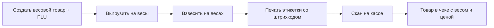
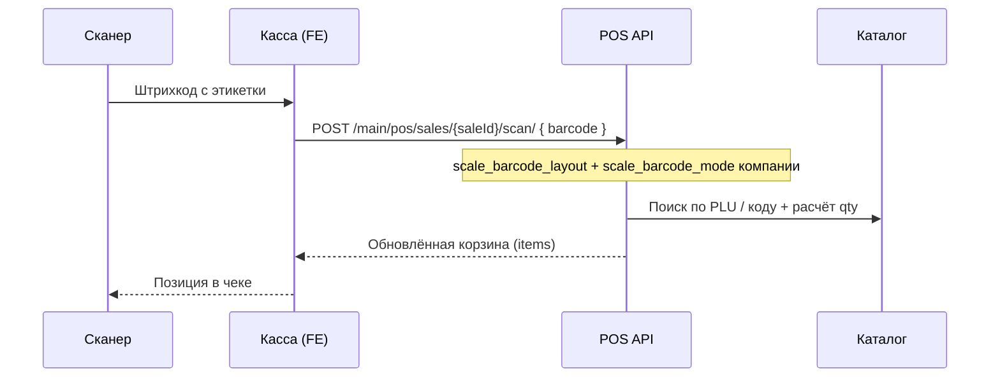

# Весы и PLU — полная документация

**Статус:** реализовано (фронт + бэкенд, июль–август 2026)  
**Аудитория:** разработчики, QA, внедрение, поддержка  
**Связанные контракты бэкенда:** [`docs/backend/scales-weight-products.md`](../backend/scales-weight-products.md)

---


## 1. Обзор

Система Nur Market поддерживает **весовые товары** — продукты, которые продаются по весу (кг, г) с этикетками, напечатанными на торговых весах. Ключевые сущности:

| Сущность | Назначение |
|----------|------------|
| **Весовой товар** | Товар с `is_weight = true` или `scale_type = "weight"` |
| **PLU** (Price Look-Up) | Числовой код товара на весах (1–99999), хранится в поле `plu` |
| **Штрихкод весов** | EAN-13 с префиксом отдела (20/21/25), PLU/кодом и весом/суммой |
| **Страница «Весы»** | Выгрузка каталога на весы Штрих-М или экспорт для Rongta |
| **Настройки чтения** | Как касса разбирает штрихкод с этикетки весов |

### Пользовательский сценарий (end-to-end)



1. Менеджер создаёт товар, включает «Весовой товар», назначает PLU.
2. На странице `/crm/scales` выгружает весовые позиции на весы (Штрих-М по сети или Rongta через файл).
3. Продавец взвешивает товар — весы печатают этикетку.
4. Кассир сканирует этикетку — POS добавляет позицию с рассчитанным количеством.

---

## 2. Термины

| Термин | Описание |
|--------|----------|
| **PLU** | Номер товара в памяти весов. В Nur CRM — поле `plu` (число). |
| **Код товара** | Внутренний код (`marketData.code`, 4 цифры, только UI). Для Rongta может попадать в штрихкод как «Код» (6 цифр). |
| **Префикс 20** | Стандартный префикс весового штрихкода (отдел 20, тип «вес в граммах»). |
| **Префикс 21** | Префикс Rongta RLS по умолчанию (отдел 21, тип штрихкода 5). |
| **Префикс 25** | Префикс штрихкода «по сумме» (сомы × 100). |
| **Раскладка «По PLU»** | Разбор: `префикс(2) + PLU(5) + значение(5) + контрольная(1)` |
| **Раскладка «По коду»** | Разбор: `префикс(2) + Код(6) + вес(4) + контрольная(1)` |
| **Режим «По весу»** | Значение в штрихкоде — граммы (делится на 1000 → кг). |
| **Режим «По сумме»** | Значение в штрихкоде — сомы × 100. |
| **Режим «Авто»** | По префиксу: 20 → вес, 25 → сумма. |

---

## 3. Модель данных

### 3.1. Поля товара (API)

| Поле | Тип | Описание |
|------|-----|----------|
| `is_weight` | `boolean` | Основной флаг весового товара |
| `scale_type` | `"weight"` \| `"piece"` \| `null` | Альтернативный маркер (legacy / дублирование) |
| `plu` | `number` \| `null` | PLU для весов; только у весовых товаров и дробных услуг |
| `unit` | `string` | Единица учёта (`кг`, `г` и т.д.) |
| `price` | `string` | Цена за единицу (за 1 кг при весовом товаре) |
| `barcode` | `string` | Основной EAN-13 (не путать с штрихкодом этикетки весов) |

**Весовым считается товар, у которого:**

```text
is_weight === true  ИЛИ  scale_type === "weight"
```

Логика на фронте: `isMarketWarehouseWeightProduct()` в `src/shared/lib/tools/marketWarehouseFilters.ts`, дублируется в `ScalesPage.tsx` как `isWeightProduct()`.

### 3.2. Поля компании (API)

| Поле | Значения | Где редактируется |
|------|----------|-------------------|
| `scale_barcode_layout` | `"plu"` \| `"code"` | `/crm/scales` → вкладка «Настройки» |
| `scale_barcode_mode` | `"auto"` \| `"weight"` \| `"amount"` | `/crm/scales` → «Настройки» **и** `/crm/set` → вкладка «Компания» |

Настройки действуют **на всю компанию** и применяются при сканировании на **всех кассах** (бэкенд разбирает штрихкод в `POST /main/pos/sales/{id}/scan/`).

### 3.3. Токен для весов

| Эндпоинт | Назначение |
|----------|------------|
| `GET /users/scales/token/` | Создание API-токена для прямой интеграции весов с бэкендом |

Токен показывается **один раз** в модальном окне (`/crm/set` → «Токен для весов»).

---

## 4. Создание весового товара и PLU

### 4.1. UI: форма товара

**Маршрут:** `/crm/sklad/add-product` (создание) или `/crm/sklad/add-product/:id` (редактирование)

**Ключевые файлы:**

| Файл | Роль |
|------|------|
| `src/features/warehouse-ops/ui/AddProductPage/components/PackagingSection.tsx` | Чекбокс «Весовой товар» / «Дробная услуга» |
| `src/features/warehouse-ops/ui/AddProductPage/components/sections/PluCodeSection.tsx` | Поле PLU (видно только для весовых) |
| `src/features/warehouse-ops/ui/AddProductPage/hooks/useAddProductBootstrap.ts` | Автогенерация PLU |
| `src/features/warehouse-ops/ui/AddProductPage/utils/productUtils.ts` | Сборка payload с `is_weight` и `plu` |

**Включение весового режима:**

- Товар: чекбокс «Весовой товар» → `marketData.isWeightProduct = true` → в API `is_weight: true`
- Услуга: чекбокс «Дробная услуга» → `marketData.isFractionalService = true` → в API `is_weight: true`
- Альтернативный путь (старая форма `ManualEntryForm`): выбор «Килограммовый товар» → `scale_type: "weight"`

### 4.2. Автогенерация PLU

При включении весового режима, если поле PLU пустое:

```text
plu = weightProductsCount + 1
```

где `weightProductsCount` — число весовых товаров на **текущей загруженной странице** списка (`productSlice`, подсчёт по `is_weight === true`).

**Рекомендация для точной нумерации:** запрашивать `GET /main/products/list/?is_weight=true` и брать `count` из ответа (как на странице весов).

При **выключении** весового режима PLU очищается на фронте.

### 4.3. Payload при сохранении

Фрагмент из `productUtils.ts`:

```json
{
  "name": "Яблоки",
  "is_weight": true,
  "plu": 42,
  "unit": "кг",
  "price": "120.000",
  "barcode": "4601234567890"
}
```

Правила:

- `plu` отправляется как **число** или `null` (не строка)
- Если весовой и PLU пуст — fallback `weightProductsCount + 1`
- Штучный товар: `is_weight: false`, `plu: null`

### 4.4. Подсказка в UI (формат штрихкода)

В tooltip поля PLU указан формат этикетки весов:

```text
[префикс] PPPPP WWWWW S
```

- `PPPPP` — PLU (5 цифр)
- `WWWWW` — вес в тысячных долях кг (граммы × 10, т.е. 145 г → `00145`)
- `S` — контрольная цифра EAN-13

### 4.5. Печать PLU на этикетках склада

В модалке печати штрихкодов A4 (`BarcodeA4PrintModal`) поле «ПЛУ» отображается, если у товара заполнен `plu`.

---

## 5. Страница «Весы» (`/crm/scales`)

**Файл:** `src/features/warehouse-ops/ui/ScalesPage.tsx`  
**Роут:** `src/app/router/routes/commonRoutes.tsx` → lazy `@features/scales`  
**Меню:** Склад → «Весы» (`src/widgets/sidebar/ui/config/`)

### 5.1. Загрузка весовых товаров

```http
GET /main/products/list/?page=1&is_weight=true
```

- Пагинация по `next` (до 100 страниц)
- Клиентский фильтр `isWeightProduct()` — подстраховка, если бэкенд проигнорировал параметр
- Счётчик на UI: количество собранных весовых позиций

### 5.2. Вкладка «Штрих-М»

Прямая отправка каталога на торговые весы через бэкенд.

```http
POST /users/scales/send-products/
Content-Type: application/json

{
  "plu_start": 1,
  "product_ids": [101, 205, 308]
}
```

| Поле | Описание |
|------|----------|
| `plu_start` | Стартовый PLU при автоназначении (всегда `1` на фронте) |
| `product_ids` | Массив UUID/id **только весовых** товаров со склада |

Поведение:

- Кнопка неактивна при `count === 0`
- Успех: alert с количеством отправленных товаров
- Ошибка: `validateResErrors` + AlertModal

**Thunk:** `sendProductsToScales` в `src/entities/user/model/userCreators.ts`

### 5.3. Вкладка «Rongta»

Экспорт файла для импорта в PLU-менеджер весов **Rongta RLS1100**.

```http
GET /main/products/scale-export/?format=txp&translit=1
```

| Параметр | Значения | Описание |
|----------|----------|----------|
| `format` | `txp` (рекомендуется), `xls` | Формат файла |
| `translit` | `0` / `1` | Транслитерация названий в латиницу (Rongta не печатает кириллицу) |

Ответ: `blob` (скачивание `scale_weight_products.TXP` или `.xls`).  
Заголовок `x-scale-products-count` — число товаров в выгрузке (опционально).

Товарам **без PLU** номер присваивается автоматически при экспорте на бэкенде.

**Важно про префиксы:** Rongta по умолчанию печатает штрихкоды с префиксом **21**, а касса по умолчанию ожидает **20**. Решения:

1. На вкладке «Настройки» страницы весов: раскладка «По коду», режим «По весу»
2. Или перенастроить префикс на самих весах на 20

### 5.4. Вкладка «Настройки» (чтение штрихкода)

Загрузка и сохранение через настройки компании:

```http
GET  /users/settings/company/
PATCH /users/settings/company/
```

```json
{
  "scale_barcode_layout": "plu",
  "scale_barcode_mode": "auto"
}
```

| `scale_barcode_layout` | Когда использовать |
|------------------------|-------------------|
| `plu` | Штрих-М и весы, где в коде зашит PLU (5 цифр) |
| `code` | Rongta RLS (в коде зашит «Код товара», 6 цифр) |

| `scale_barcode_mode` | Когда использовать |
|---------------------|-------------------|
| `auto` | Универсально: префикс 20 → вес, 25 → сумма |
| `weight` | Всегда интерпретировать значение как граммы |
| `amount` | Всегда интерпретировать значение как сомы × 100 |

**Пример диагностики раскладки** (из UI):

Вызвали PLU 1, вес 0.145 кг, этикетка: `2100100001452`

| Раскладка | Разбор | Результат |
|-----------|--------|-----------|
| По PLU | `21` \| `00100` \| `00145` \| `2` | PLU = 100 — **не тот товар** |
| По коду | `21` \| `001000` \| `0145` \| `2` | Код 1000 → PLU = 1, вес 0.145 кг — **верно** |

---

## 6. Настройки компании

### 6.1. Токен для весов

**Путь:** `/crm/set` → вкладка «Токен для весов»  
**Файлы:** `ScalesTokenTab.tsx`, `Settings.tsx` → `handleCreateScalesToken`

```http
GET /users/scales/token/
```

Ответ может содержать токен в полях `scale_api_token`, `token` или `access_token`. Токен показывается один раз в модальном окне с кнопкой копирования.

### 6.2. Режим штрихкода весов (дублирование)

**Путь:** `/crm/set` → «Компания» → «Режим значения штрихкода весов»  
**Файл:** `CompanyTab.tsx`

Редактируется только `scale_barcode_mode` (без `scale_barcode_layout`). Полная пара layout + mode — на странице `/crm/scales` → «Настройки».

---

## 7. Касса и сканирование

### 7.1. Поток сканирования



**Thunk:** `sendBarCode` → `POST /main/pos/sales/{targetId}/scan/`  
**Файлы кассы:** `useCashierBarcode.ts`, `BarcodeScanner.tsx`, `useBarcodeToCart.ts`

Тело запроса:

```json
{ "barcode": "2100100001452", "sale_id": "optional-uuid" }
```

Разбор штрихкода весов выполняется **на бэкенде** с учётом `scale_barcode_layout` и `scale_barcode_mode` компании. Фронт передаёт штрихкод как есть.

### 7.2. Отличие от обычного штрихкода

| Тип | Поведение |
|-----|-----------|
| Обычный EAN-13 товара | Поиск по `barcode` / `alternate_barcodes`, qty = 1 (или выбор упаковки) |
| Штрихкод весов | Разбор PLU/кода + извлечение веса/суммы, qty = вес в кг |
| Доп. штрихкод | Фолбэк на фронте, если POS вернул «не найден» (`alternate_barcodes`) |

### 7.3. Весовые товары в UI кассы

- Количество в корзине — дробное (до 3 знаков)
- Ввод количества: `inputMode="decimal"` для весовых (`AddProductModal`, `MarriageModal`)
- Фильтр склада: вкладка «Весовые» → `?is_weight=true` (`marketWarehouseFilters.ts`)

---

## 8. API — сводная таблица

| Метод | Путь | Назначение |
|-------|------|------------|
| `GET` | `/main/products/list/?is_weight=true` | Список весовых товаров |
| `GET` | `/main/products/scale-export/` | Экспорт для Rongta (.TXP / .xls) |
| `POST` | `/users/scales/send-products/` | Отправка на весы Штрих-М |
| `GET` | `/users/scales/token/` | Создание токена интеграции |
| `GET` / `PATCH` | `/users/settings/company/` | `scale_barcode_layout`, `scale_barcode_mode` |
| `POST` | `/main/pos/sales/{id}/scan/` | Скан штрихкода (в т.ч. весов) |
| `POST` / `PATCH` | `/main/products/` | Создание/обновление товара (`is_weight`, `plu`) |

Подробный чек-лист приёмки фильтра `is_weight`: [`docs/backend/scales-weight-products.md`](../backend/scales-weight-products.md).

---

## 9. Структура кода (FSD)

```
src/
├── features/
│   ├── scales/
│   │   └── index.ts                    # re-export ScalesPage
│   └── warehouse-ops/ui/
│       ├── ScalesPage.tsx              # Страница весов (3 вкладки)
│       ├── ScalesPage.scss
│       └── AddProductPage/
│           ├── components/sections/PluCodeSection.tsx
│           ├── hooks/useAddProductBootstrap.ts   # автогенерация PLU
│           └── utils/productUtils.ts             # is_weight + plu в payload
├── entities/
│   ├── user/model/userCreators.ts      # sendProductsToScales, getScalesToken
│   ├── sale/model/saleThunk.ts         # sendBarCode → POS scan
│   └── product/model/productSlice.ts   # weightProductsCount
├── pages/
│   ├── settings/ui/Settings/
│   │   ├── tabs/ScalesTokenTab.tsx
│   │   └── tabs/CompanyTab.tsx         # scale_barcode_mode
│   └── cashier/ui/hooks/cashier/
│       └── useCashierBarcode.ts        # обработка скана
└── shared/lib/tools/
    └── marketWarehouseFilters.ts       # isMarketWarehouseWeightProduct
```

**i18n:** ключи `crm.scales.*` и `settings.scalesToken.*` в `public/locales/ru/translation.json`.

---

## 10. Типичные проблемы и решения

| Симптом | Вероятная причина | Решение |
|---------|-------------------|---------|
| «Товар не найден» при скане этикетки | Неверная раскладка (`plu` vs `code`) | Сверить этикетку по инструкции на вкладке «Настройки» `/crm/scales` |
| Неверный вес в чеке | Неверный режим (`weight` vs `amount`) | Проверить `scale_barcode_mode`; для Rongta обычно «По весу» |
| Префикс 21 vs 20 | Rongta печатает отдел 21 | Раскладка «По коду» + режим «По весу», или сменить префикс на весах |
| PLU не совпадает | Товар не выгружен на весы / другой PLU | Повторить выгрузку; сверить `plu` в карточке товара и в памяти весов |
| Кириллица «?????» на Rongta | Прошивка весов | Включить транслитерацию при экспорте |
| Дублирующиеся PLU | Ручной ввод / устаревший count | Задать PLU вручную; для автогенерации использовать `?is_weight=true` count |
| Нет весовых на странице весов | Товары не помечены весовыми | Включить «Весовой товар» в карточке |
| `product_ids: []` при отправке | Пустой склад весовых | Создать/пометить товары как весовые |

---

## 11. Чек-лист QA

### Создание товара

- [ ] Чекбокс «Весовой товар» показывает блок PLU
- [ ] PLU автогенерируется при включении весового режима
- [ ] PLU очищается при выключении весового режима
- [ ] В API уходит `is_weight: true` и числовой `plu`
- [ ] Штучный товар: `is_weight: false`, `plu: null`

### Страница весов

- [ ] Счётчик весовых совпадает с `GET ?is_weight=true`
- [ ] Штрих-М: отправка только весовых `product_ids`
- [ ] Rongta: скачивается .TXP, опционально translit
- [ ] Настройки layout/mode сохраняются и переживают перезагрузку

### Касса

- [ ] Скан этикетки весов добавляет позицию с правильным весом
- [ ] Сумма строки = цена за кг × вес
- [ ] При несовпадении PLU — понятная ошибка «товар не найден»

### Настройки

- [ ] Токен создаётся и копируется один раз
- [ ] `scale_barcode_mode` в «Компании» синхронизирован с `/crm/scales`

---

## 12. Связанные документы

| Документ | Тема |
|----------|------|
| [`docs/backend/scales-weight-products.md`](../backend/scales-weight-products.md) | Контракт `?is_weight=true`, `send-products` |
| [`docs/market/add-product-page.md`](./add-product-page.md) | Форма товара, PLU, bootstrap |
| [`docs/flutter/add-product.md`](../flutter/add-product.md) | Паритет мобильного клиента (PLU, весовой флаг) |
| [`docs/PROJECT.md`](../PROJECT.md) | Маршруты, FSD, обзор домена |

---

## 13. История изменений

| Дата | Изменение |
|------|-----------|
| Июль 2026 | Бэкенд: фильтр `?is_weight=true`; фронт: страница весов с клиентской подстраховкой |
| Авг 2026 | Вкладки Rongta (scale-export), настройки раскладки штрихкода, i18n |
| Авг 2026 | Документ объединяет фронт, API и сценарии внедрения |
